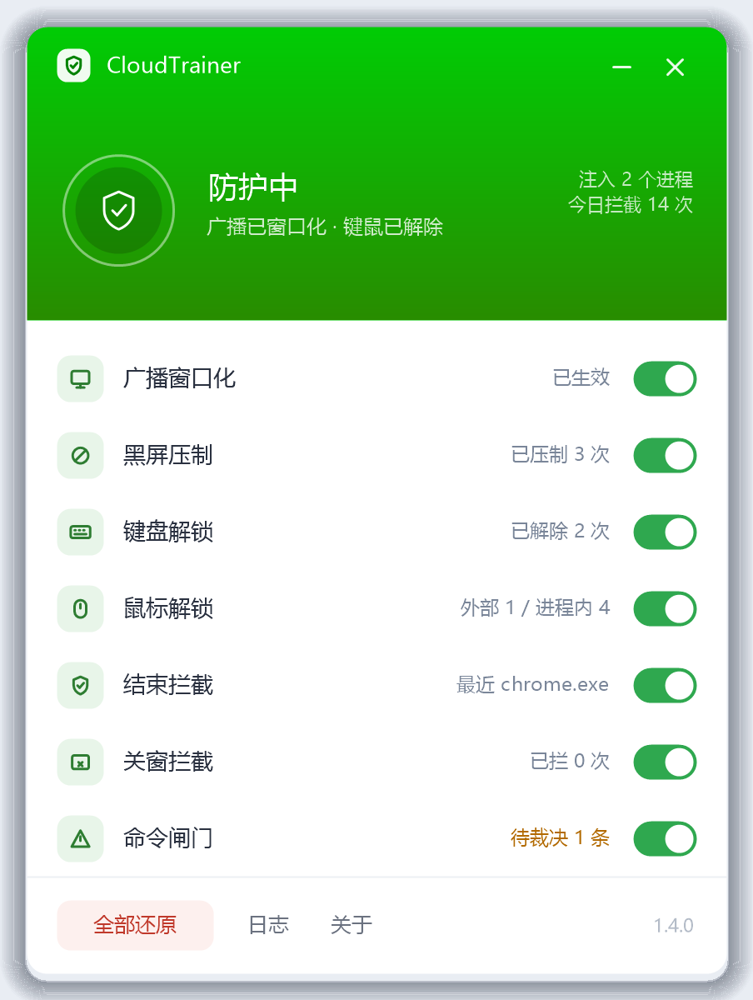

# CloudTrainer

> 把 [JiYuTrainer](https://github.com/imengyu/JiYuTrainer) 的**技术思路**，重新实现为针对
> **联想电子教室（NeiCloud）**学生端的 Windows 工具。

**版本** 1.4.0　·　**形态** 单文件 exe（x86、原生 Win32、无安装、无运行库依赖）　·　**系统** Windows 10+

---

## 界面



420×568 自绘界面（GDI+），视觉语言沿用 JiYuTrainer：状态色渐变头区 + 圆角卡片。
头部状态随环境变色（绿=防护中、蓝=待机、橙=降级、灰=未连接），下面 7 项能力各带开关和实时计数。

设计稿由程序自己渲染，和运行时是同一份绘制代码：

```bash
CloudTrainer.exe --uipreview .\preview     # 输出 -window / -1x / -main / -degraded / -gate.png
```

---

## 能力

| # | 能力 | 做什么 |
|---|---|---|
| G1 | **广播窗口化** | 全屏广播变成可拖动 / 可最小化 / 可被遮挡的窗口，并取消置顶 |
| G2 | **黑屏压制** | `BlackSlient.exe` 一出现就结束 |
| G3 | **解除键盘锁** | 结束 `PDelKeyB.exe`，全局钩子随线程退出即失效 |
| G4 | **解除鼠标锁** | 外部投递 `WM_QUIT` + 进程内摘钩双通道，**后手启动**也能解开 |
| G5 | **拦截结束请求** | 挡住“程序使用限制”对非白名单进程的清理 |
| G6 | **命令闸门 / 网络限制** | 教师端远程命令在本机裁决；挡住“网络使用限制”下发 |
| G7 | **紧急热键** | `Ctrl+Alt+F / H / D` |
| G8 | **托盘常驻** | 托盘图标 + 状态窗 + 命令裁决窗 |
| G9 | **单文件发行** | 载荷内嵌在 exe 尾部（CRC 校验），运行期读回 |

只有 G4 的进程内通道、G5、G6 需要注入目标进程；G2/G3 直接结束对应进程，G1 优先从外部改窗口。

界面里的 7 个开关对应 G1–G6 再加「关窗拦截」；G7–G9 是配套机制，不可切换。

**默认全开**：`startupEnableAll=1`，每次启动 7 项能力全部打开。托盘中可临时关闭（只影响本次会话），
重启后恢复全开；想“关掉就一直关着”，把它改成 `0`。

---

## 快速上手

```
CloudTrainer.exe                启动（弹 UAC，托盘常驻）
CloudTrainer.exe --probe        只读体检：安装目录 / 指纹比对 / 进程与 HookLib 宿主
CloudTrainer.exe --winlist      只读体检：可见窗口列表 + 广播判定结果
CloudTrainer.exe --netprobe     只读体检：防火墙 / 代理 / Inspect 驱动 / 限制执行器
CloudTrainer.exe --unlock       一次性解除键鼠锁（不建窗口，做完就退）
CloudTrainer.exe --no-elevate   不提权运行（注入类能力自动降级）
CloudTrainer.exe --elevated     内部使用，提权重启时带上
```

**建议以管理员运行**：G4 的进程内通道、G5、G6 需要管理员权限，普通权限下会自动降级（窗口/黑屏/键鼠仍可用）。

第一次建议先跑 `--probe`，确认指纹与你的版本一致。广播异常时先跑 `--winlist`：
它能直接区分“没认出广播窗口”和“广播根本没创建”。

### 热键

| 热键 | 行为 |
|---|---|
| `Ctrl+Alt+F` | 假装黑屏（全屏黑窗 + 吞键盘，不锁鼠标），再按一次退出 |
| `Ctrl+Alt+H` | 全部还原：**3 秒内按两次**才执行 |
| `Ctrl+Alt+D` | 显示 / 隐藏状态窗口 |

### 配置

`%LOCALAPPDATA%\CloudTrainer\config.ini`，改完重启生效；托盘里也能随时切换。

| 键 | 默认 | 说明 |
|---|---|---|
| `startupEnableAll` | 1 | 每次启动强制全开（0 = 按下面的开关来） |
| `fixBroadcast` | 1 | 广播窗口化 |
| `fixWidth` / `keepAspect` | 1280 / 1 | 窗口宽度；按显示器比例换算高度 |
| `allowTopmost` | 0 | 窗口化后是否仍置顶 |
| `killBlackScreen` | 1 | 黑屏压制 |
| `unlockKeyboard` / `unlockMouse` | 1 / 1 | 解除键鼠锁 |
| `blockTerminate` / `blockClose` | 1 / 1 | 拦截结束请求 / 跨进程关窗 |
| `protectUserApps` | 1 | 保护任意非厂商用户程序不被清理 |
| `cmdGate` / `cmdGateTimeout` | 1 / 20 | 远程命令裁决；等待秒数 |
| `selfProtect` / `appShield` | 1 / 1 | 自我保护 / 给用户程序加“禁止结束” |
| `netGuard` | 1 | 拒绝访问 `\\.\Inspect` 设备并拦截其 IOCTL |
| `netKillLimit` | 1 | 发现 `mmcLimitConsole` 直接结束 |
| `netStopDriver` | 0 | 额外停掉 `Inspect` 驱动服务（更彻底，默认关） |
| `autoInject` | 1 | 自动注入目标进程 |
| `strictVersion` | 0 | 1 = 指纹不匹配就降只读 |
| `installDir` | 空 | 非默认安装路径时手工指定 |

### 「全部还原」

把我改过的都还回去：撤假黑屏 → 还原广播窗 → 卸载所有 hook → 载荷线程退出，
同时把 7 项能力**全部关掉**（否则 5 秒后策略下发又会把注入装回去）。
**不会**把键鼠重新锁上——那是厂商的事。

因为默认 `startupEnableAll=1`，下次启动又是全开；只有把它改成 `0`，“关掉”才会跨重启保留。

---

## 实现概要

- **窗口层**：类名锚定广播窗口（进程名读不到也认）；外部每 tick 持续纠正样式与层级，
  注入 `MultiRender.exe` 后子类化窗口，接管非客户区、置顶、拖动位置和光标。
- **进程 / 线程层**：黑屏、键盘锁是独立进程，直接结束；鼠标锁定位 `HookLib.dll` 的锁线程，
  先投 `WM_QUIT`，不成就进进程内 `UnhookWindowsHookEx`。
- **注入层**：自实现反射加载器（不落盘），IAT hook `TerminateProcess` / `CreateProcess` /
  `CreateFile` / `DeviceIoControl`；主程序与载荷通过共享内存通信。
- **网络限制**：拒绝打开 `\\.\Inspect`、拒绝其 IOCTL，并清理 `mmcLimitConsole` 执行器。

实现细节与逆向证据见 [docs/MECHANISM.md](docs/MECHANISM.md)、[docs/IMPLEMENTATION.md](docs/IMPLEMENTATION.md)。

---

## 代码结构

```
CloudTrainer/
├─ build.py                     一键构建（自动找 / 下载 zig）
├─ src/
│  ├─ common/
│  │  ├─ TargetDefs.h           ★ 唯一允许出现目标产品标识符的地方
│  │  └─ CtIpc.h                主程序 ↔ 载荷 的共享内存协议
│  ├─ main/                     CloudTrainer.exe（x86 GUI）
│  │  ├─ Core.*                 工具、日志、配置、目标发现、版本指纹
│  │  ├─ Guards.cpp             G1 窗口 / G2 黑屏 / G3 键盘 / G4 鼠标
│  │  ├─ Unlock.*               解锁原语（可单独测试）
│  │  ├─ Reflect.*              反射加载器
│  │  ├─ Inject.cpp             会话管理与注入线程
│  │  ├─ Ui / UiTheme           GDI+ 界面与托盘
│  │  ├─ Probe.cpp              --probe / --netprobe / --unlock / --winlist
│  │  └─ CtMain.cpp             外壳、消息循环、调度、热键
│  └─ payload/                  注入载荷（无 CRT）
│     ├─ payload.cpp            主循环、心跳、解锁
│     ├─ winguard.cpp           广播窗口子类化
│     └─ hooks.cpp              IAT hook + 命令闸门 + 设备守卫
├─ tests/                       不依赖电子教室的端到端测试
├─ tools/                       PE 自检脚本 + 本地工具链
├─ docs/                        机制 / 实现对照 / 安全 / 构建说明
└─ dist/                        构建产物
```

**架构硬约束**：除 `src/common/TargetDefs.h` 外，任何源文件都不允许出现目标产品的进程名、
类名、导出名。适配新版本只改这一个头文件。

---

## 构建

工程自带 **zig** 工具链（自带 mingw-w64 头与库），不需要 MSVC / CMake：

```bash
python build.py            # 增量构建（约 5 秒）
python build.py --clean    # 清理重建
```

流程：找 zig（`ZIG` 环境变量 → `tools/zig/zig.exe` → 自动下载）→ 编译载荷与主程序 →
把载荷追加到 exe 尾部并写 footer（magic / size / crc32）→ 自检架构与 CRC。

产物：

```
dist/CloudTrainer.exe         740 KB   单文件（内含载荷）
dist/CloudTrainerPayload.dll  211 KB   仅留档，便于排错
```

工具链约 476 MB（`zig.exe` + `lib/` + 编译缓存），已加入 `.gitignore`。
缓存放在工具链旁边而非 `build/`，这样“清掉 build 再构建”仍是 5 秒。
细节与取舍见 [docs/BUILD.md](docs/BUILD.md)。

---

## 测试

三套端到端测试，全部使用仓库自带的模拟程序，**不启动任何电子教室进程**：

```bash
python build.py
python tests/run_inject_test.py     # 反射注入 + 命令闸门 + 卸载
python tests/run_unlock_test.py     # 外部解锁：定位、投递、失败上报
python tests/run_winguard_test.py   # 窗口守卫：拖动不再回弹
```

另外两个只读自检：`tools/inspect.py`（PE 结构）、`tools/check_imports.py`（导入解析）。
说明见 [tests/README.md](tests/README.md)。

---

## 已知限制

1. **版本敏感**：指纹锁定 2022–2023 的构建。不匹配时降级但仍全功能；只有找不到 `Student.exe`
   或打开 `strictVersion=1` 才退成只读。换版本时改 `TargetDefs.h` 即可。
2. **IAT hook 的边界**：厂商若改成动态 `GetProcAddress`，G5/G6 会失效（不会崩）。
3. **命令闸门会阻塞调用线程**：最多等 `cmdGateTimeout` 秒；主程序不在线时直接放行。
4. **载荷内存不回收**：还原后约 200 KB 只读内存留在目标进程，直到它重启。
5. **只针对 x86**：`PDelKeyB.exe` 是 x64，只结束、不注入。
6. **自保护有边界**：DACL 只挡同用户身份的结束请求，挡不住 SYSTEM / 驱动 / Job Object；
   副作用是被保护的程序在任务管理器里“结束任务”会失败（重启恢复）。
7. **网络层是“阻断下发”**：不删除已经装进内核的过滤器；那种情况需要重启，
   或临时打开 `netStopDriver=1`。
8. **不做的事**：反监视、破解教师端 / 卸载口令、启停学生端、断网锁屏、驱动、自动更新、免杀。

---

## 合规

- 仅用于**个人学习**与**自有设备**，或在**已获得授权**的教学环境中使用。
- 本项目**不联网**、不上报、不写目标产品目录、不改其配置文件、不启停学生端进程。
- 使用后果自负。不确定自己是否有权这么做，就不要用。

安全与写盘说明见 [docs/SECURITY.md](docs/SECURITY.md)，第三方声明见 [docs/NOTICE.md](docs/NOTICE.md)。

MIT License.
